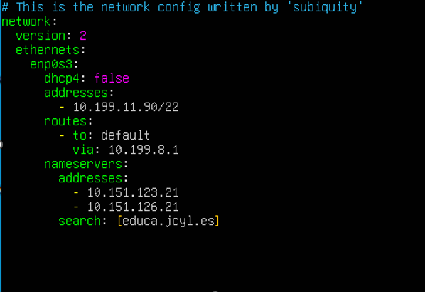
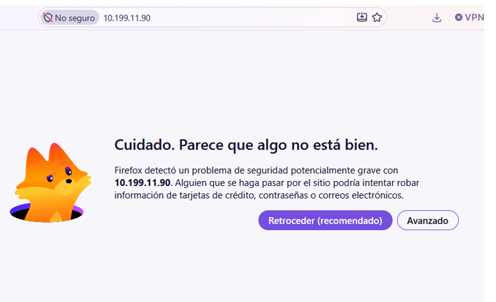
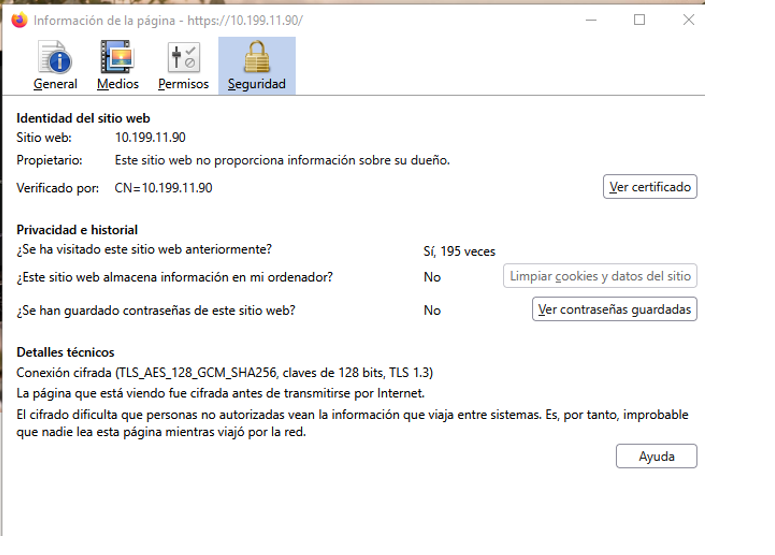

# Manual de preparación del servidor web Ubuntu (YRM-USED)

*(Servidor de desarrollo para aplicaciones web basadas en PHP)*

---

## Contenido de la guía

- [Manual de preparación del servidor web Ubuntu (YRM-USED)](#manual-de-preparación-del-servidor-web-ubuntu-yrm-used)
  - [Contenido de la guía](#contenido-de-la-guía)
  - [1. Preparación inicial del servidor](#1-preparación-inicial-del-servidor)
    - [1.1. Preparar la máquina e instalar Ubuntu](#11-preparar-la-máquina-e-instalar-ubuntu)
    - [1.2. Ajustes de red y nombre del equipo](#12-ajustes-de-red-y-nombre-del-equipo)
    - [1.3. Actualizaciones, acceso remoto y seguridad básica](#13-actualizaciones-acceso-remoto-y-seguridad-básica)
    - [1.4. Revisar el sistema y probar el acceso](#14-revisar-el-sistema-y-probar-el-acceso)
  - [2. Usuarios con permisos de administración](#2-usuarios-con-permisos-de-administración)
    - [2.1. Crear una segunda cuenta administrativa](#21-crear-una-segunda-cuenta-administrativa)
  - [3. Apache2: puesta en marcha del servidor web](#3-apache2-puesta-en-marcha-del-servidor-web)
    - [3.1. Instalar Apache y comprobar el servicio](#31-instalar-apache-y-comprobar-el-servicio)
    - [3.2. Registro de errores y página para errores 404](#32-registro-de-errores-y-página-para-errores-404)
    - [3.3. Permitir reglas propias con AllowOverride](#33-permitir-reglas-propias-con-allowoverride)
    - [3.4. Activar HTTPS con un certificado autofirmado](#34-activar-https-con-un-certificado-autofirmado)
    - [3.5. Enviar las peticiones HTTP hacia HTTPS](#35-enviar-las-peticiones-http-hacia-https)
  - [4. Cuenta de trabajo web: operadorweb](#4-cuenta-de-trabajo-web-operadorweb)
    - [4.1. Crear el usuario y asignar permisos sobre la web](#41-crear-el-usuario-y-asignar-permisos-sobre-la-web)
  - [5. PHP-FPM: ejecutar PHP desde Apache](#5-php-fpm-ejecutar-php-desde-apache)
    - [5.1. Instalar el servicio PHP-FPM](#51-instalar-el-servicio-php-fpm)
    - [5.2. Conectar PHP-FPM con Apache](#52-conectar-php-fpm-con-apache)
    - [5.3. Ajustar PHP para trabajar en desarrollo](#53-ajustar-php-para-trabajar-en-desarrollo)
  - [6. MariaDB: instalación y configuración de la base de datos](#6-mariadb-instalación-y-configuración-de-la-base-de-datos)
    - [6.1. Instalar MariaDB y habilitar acceso remoto](#61-instalar-mariadb-y-habilitar-acceso-remoto)
    - [6.2. Crear una cuenta administradora de SQL](#62-crear-una-cuenta-administradora-de-sql)
    - [6.3. Aplicar los ajustes básicos de seguridad](#63-aplicar-los-ajustes-básicos-de-seguridad)
  - [7. phpMyAdmin: administrar bases de datos desde el navegador](#7-phpmyadmin-administrar-bases-de-datos-desde-el-navegador)
  - [8. Xdebug: depurar código PHP paso a paso](#8-xdebug-depurar-código-php-paso-a-paso)
  - [9. Sitios virtuales y página de inicio predeterminada](#9-sitios-virtuales-y-página-de-inicio-predeterminada)
  - [10. SFTP con usuarios limitados a su directorio](#10-sftp-con-usuarios-limitados-a-su-directorio)
  - [11. Documentación del código con phpDocumentor](#11-documentación-del-código-con-phpdocumentor)

---

## 1. Preparación inicial del servidor

En este primer apartado se prepara la máquina virtual y se comprueba que Ubuntu está instalado correctamente. También se configura la red y se dejan listos algunos servicios básicos para poder administrar el servidor.

### 1.1. Preparar la máquina e instalar Ubuntu

Antes de empezar a instalar y configurar los servicios, se establecen los recursos de la máquina virtual y se revisan las características del sistema.

- **Nombre de la máquina:** `YRM-USED`
- **RAM:** `2048 MB` (2 GB)
- **Particiones:** `150GB` (`/`), `350GB` (`/var`) y `4GB` de `swap`.

Para consultar la versión del sistema, la información del kernel, los discos y el espacio disponible, se pueden utilizar estos comandos:

```bash
uname -a
lsb_release -a
lsblk
df -h
lsblk -fm
lsblk -a
sudo fdisk -l
```

### 1.2. Ajustes de red y nombre del equipo

Para identificar el servidor se establece el nombre `YRM-USED`. Después se configura una dirección IP estática, utilizando los parámetros correspondientes al entorno de clase o al de casa.

Cambiar el nombre del equipo y revisar el archivo de hosts:

```bash
sudo hostnamectl set-hostname YRM-USED
sudo nano /etc/hosts
```

Para modificar la configuración de red, se accede al directorio de Netplan y se hace una copia del archivo antes de editarlo:

```bash
cd /etc/netplan
ls
sudo cp 00-installer-config.yaml 00-installer-config.yaml.backup
sudo nano 00-installer-config.yaml
```

**Parámetros de red en CLASE:**



**Parámetros de red en CASA (se fija la IP en 100):**

```yaml
network:
  ethernets:
    enp0s3:
      addresses:
        - 192.168.1.100/24
      nameservers:
        addresses:
          - 8.8.8.8
          - 8.8.4.4
      routes:
        - to: default
          via: 192.168.1.1
  version: 2
```

Una vez seleccionada y guardada la configuración correspondiente, se aplica con:

```bash
sudo netplan apply
```

Para revisar que la red se ha configurado como se esperaba, se consultan las direcciones IP, las rutas y los servidores DNS:

```bash
ip a
ip r
resolvectl status
```

### 1.3. Actualizaciones, acceso remoto y seguridad básica

Con la red preparada, se actualiza el sistema y se establece la zona horaria. También se habilita el cortafuegos y se instala ClamAV como herramienta de análisis antivirus.

Actualizar los paquetes e indicar la zona horaria de España:

```bash
sudo apt update && sudo apt upgrade -y
date
sudo timedatectl set-timezone Europe/Madrid
```

Activar el cortafuegos y permitir las conexiones SSH por el puerto 22:

```bash
sudo ufw enable
sudo ufw allow 22/tcp
```

Instalar ClamAV y actualizar sus definiciones de virus:

```bash
sudo apt install clamav clamav-daemon -y
sudo systemctl stop clamav-freshclam
sudo freshclam
sudo systemctl start clamav-freshclam
sudo systemctl enable clamav-freshclam
```

### 1.4. Revisar el sistema y probar el acceso

Para comprobar que el equipo responde a través de la red, se hace una prueba de `ping` desde el terminal del ordenador anfitrión. Después se intenta acceder al servidor mediante SSH.

```bash
ping 10.199.11.90
ssh miadmin@10.199.11.90
```

Si la conexión SSH funciona, se podrá administrar el servidor desde otro equipo sin tener que trabajar directamente en la consola de la máquina virtual.

---

## 2. Usuarios con permisos de administración

Es conveniente disponer de otra cuenta con permisos administrativos para poder realizar tareas de mantenimiento sin depender de una única cuenta de usuario.

### 2.1. Crear una segunda cuenta administrativa

Se crea el usuario `miadmin2` y se incorpora a varios grupos del sistema. Entre ellos está `sudo`, que permite ejecutar comandos con privilegios de administración.

```bash
sudo useradd -m -G sudo,adm,cdrom,dip,plugdev,lxd -s /bin/bash miadmin2
sudo passwd miadmin2
```

El segundo comando permite establecer la contraseña de la nueva cuenta.

Para comprobar los grupos y revisar las cuentas creadas, se consultan los archivos de usuarios y grupos:

```bash
cat /etc/group | grep miadmin
cat /etc/passwd | grep miadmin
```

---

## 3. Apache2: puesta en marcha del servidor web

Apache es el servicio que recibe las peticiones de los navegadores y entrega los recursos de la web que están almacenados en el servidor. En este apartado se instala y se prepara para trabajar con HTTP y HTTPS.

### 3.1. Instalar Apache y comprobar el servicio

Primero se actualiza la información de los paquetes y se instala Apache. Después se permite el tráfico HTTP en el cortafuegos y se comprueba el estado del servicio.

```bash
sudo apt update
sudo apt install apache2 -y
sudo ufw allow 80
sudo systemctl status apache2
```

Si el servicio está activo, Apache estará preparado para atender peticiones por el puerto 80.

### 3.2. Registro de errores y página para errores 404

Apache permite guardar los errores que se producen durante el funcionamiento del servidor. También se puede indicar qué página debe mostrarse cuando alguien intenta acceder a una dirección que no existe.

Se crea un directorio para guardar los archivos relacionados con los errores:

```bash
sudo mkdir /var/www/html/error
sudo touch /var/www/html/error/error.log
```

Antes de modificar la configuración del sitio web predeterminado, se guarda una copia del archivo original:

```bash
cd /etc/apache2/sites-available
sudo cp 000-default.conf 000-default.conf.backup
sudo nano 000-default.conf
```

Dentro del bloque `<VirtualHost *:80>`, se añaden o se modifican estas directivas:

```apache
ErrorLog /var/www/html/error/error.log
ErrorDocument 404 /error/404.html
```

`ErrorLog` indica dónde se guardan los errores de Apache. `ErrorDocument 404` establece la página que se mostrará cuando no se encuentre el recurso solicitado. Para que esta última directiva funcione como se espera, debe existir el archivo `/var/www/html/error/404.html`.

### 3.3. Permitir reglas propias con AllowOverride

Los archivos `.htaccess` permiten establecer ciertas reglas de configuración dentro de un directorio sin tener que editar el archivo principal del sitio virtual. Para que Apache acepte estas reglas, hay que activar el módulo `rewrite` y permitir las modificaciones mediante `AllowOverride`.

Activar el módulo:

```bash
sudo a2enmod rewrite
```

Abrir el archivo de configuración general de Apache:

```bash
sudo nano /etc/apache2/apache2.conf
```

Dentro del bloque correspondiente al directorio `/var/www/`, se cambia el valor de `AllowOverride` a `All`. La configuración debe quedar con esta estructura:

```apache
<Directory /var/www/>
    ...
    AllowOverride All
</Directory>

ServerName yrm-used
```

La directiva `AllowOverride All` permite que Apache lea las reglas autorizadas que se hayan definido en los archivos `.htaccess`. `ServerName` establece el nombre principal del servidor.

Comprobar que no hay errores de sintaxis:

```bash
sudo apache2ctl configtest
```

Si la comprobación termina correctamente, se puede recargar la configuración y reiniciar el servicio para aplicar los cambios:

```bash
sudo systemctl reload apache2
sudo systemctl restart apache2
```

### 3.4. Activar HTTPS con un certificado autofirmado

HTTPS protege la comunicación entre el navegador y el servidor mediante cifrado. Para habilitarlo en este entorno de desarrollo se genera un certificado autofirmado. Es útil para hacer pruebas, aunque el navegador mostrará un aviso porque el certificado no está emitido por una autoridad de confianza.

Se activa el módulo SSL de Apache, que permite gestionar las conexiones HTTPS:

```bash
sudo a2enmod ssl
```

A continuación, se crea el certificado junto con su clave privada:

```bash
sudo openssl req -x509 -nodes -days 365 -newkey rsa:2048 -keyout /etc/ssl/private/apache-selfsigned.key -out /etc/ssl/certs/apache-selfsigned.crt
```

Cada parte del comando tiene una función concreta:

- **`openssl req`**: permite generar solicitudes de certificado y crear certificados con las opciones adecuadas.
- **`-x509`**: genera directamente un certificado autofirmado.
- **`-nodes`**: crea la clave privada sin protegerla mediante una contraseña.
- **`-days 365`**: establece una validez de 365 días.
- **`-newkey rsa:2048`**: genera una clave RSA nueva de 2048 bits.
- **`-keyout`**: indica la ruta donde se guardará la clave privada.
- **`-out`**: señala el archivo en el que se almacenará el certificado.

Durante la creación del certificado, el sistema solicita algunos datos. En esta configuración se introducen los siguientes valores, que pueden adaptarse si cambian las necesidades del servidor:

- **Country Name:** `ES`
- **State or Province Name:** `ZAMORA`
- **Locality Name:** `BENAVENTE`
- **Organization Name:** `IES LOS SAUCES`
- **Organizational Unit Name:** `DAW2`
- **Common Name:** `yrm-used`
- **Email Address:** dejar en blanco.

El campo `Common Name` identifica el nombre del servidor para el que se crea el certificado. En un entorno real también es importante que el certificado incluya los nombres o direcciones con los que se vaya a acceder al sitio.

Después se prepara la configuración del sitio virtual seguro. Se hace una copia del archivo original y se abre para editarlo:

```bash
cd /etc/apache2/sites-available/
sudo cp default-ssl.conf default-ssl.conf.backup
sudo nano default-ssl.conf
```

Dentro del bloque `<VirtualHost *:443>`, se comprueba que estén configuradas estas directivas:

```apache
ServerAdmin webmaster@localhost
ServerName 10.199.11.90
DocumentRoot /var/www/html
SSLEngine on
SSLCertificateFile /etc/ssl/certs/apache-selfsigned.crt
SSLCertificateKeyFile /etc/ssl/private/apache-selfsigned.key
ErrorLog ${APACHE_LOG_DIR}/yrm-ssl-error.log
CustomLog ${APACHE_LOG_DIR}/yrm-ssl-access.log combined
```

Con esta configuración, Apache utiliza el certificado y la clave que se acaban de crear, sirve los archivos desde `/var/www/html` y guarda los registros de acceso y de errores en archivos separados.

Se activa el sitio seguro, se permite el puerto 443 y se reinicia Apache:

```bash
sudo a2ensite default-ssl.conf
sudo ufw allow 443
sudo systemctl restart apache2
```

Para comprobar el resultado, se abre en el navegador la dirección:

`https://10.199.11.90`

Como el certificado es autofirmado, el navegador avisará de que la conexión no se puede verificar mediante una autoridad de confianza. Esto es esperable en estas pruebas.



Para revisar los datos introducidos al generar el certificado, se puede abrir la información de seguridad de la conexión desde el aviso del navegador.



### 3.5. Enviar las peticiones HTTP hacia HTTPS

Para evitar que la web se utilice mediante una conexión HTTP sin cifrar, se configura una regla que redirige esas peticiones a HTTPS. En este caso, el archivo `.htaccess` se modifica con el usuario `operadorweb`, desde CMD o MobaXterm, según el método de conexión utilizado.

Se comprueba que el módulo `rewrite` esté activado:

```bash
sudo a2enmod rewrite
```

Se abre el archivo `.htaccess` situado en la raíz de la web:

```bash
sudo nano /var/www/html/.htaccess
```

Se añaden las siguientes reglas:

```apache
RewriteEngine On
RewriteCond %{SERVER_PORT} 80
RewriteRule ^(.*)$ https://10.199.11.90/$1 [R,L]
```

La primera línea activa el motor de reescritura. La condición comprueba si la petición se ha recibido por el puerto 80, que es el utilizado por HTTP. Cuando se cumple, la regla envía al navegador a la dirección HTTPS, conservando el resto de la ruta solicitada. Las opciones `[R,L]` indican que se realiza una redirección y que no se siguen evaluando las reglas posteriores en esa misma pasada.

Para terminar, se comprueba la configuración de Apache y se recarga el servicio:

```bash
sudo apache2ctl configtest
sudo systemctl reload apache2
```

---

## 4. Cuenta de trabajo web: operadorweb

La cuenta `operadorweb` se utiliza para trabajar con los archivos de la web sin tener que usar directamente una cuenta de administración del sistema. Se crea después de instalar y configurar PHP, siguiendo el orden previsto para preparar el servidor.

### 4.1. Crear el usuario y asignar permisos sobre la web

Se crea el usuario sin un directorio personal independiente. Se establece `/var/www/html` como directorio de trabajo y se le asigna el grupo `www-data`, que utiliza Apache para gestionar los archivos web.

```bash
sudo useradd -M -d /var/www/html -N -g www-data -s /bin/bash operadorweb
sudo passwd operadorweb
```

El segundo comando permite establecer la contraseña de `operadorweb`.

A continuación, se asigna la propiedad del contenido web a ese usuario y al grupo `www-data`. Después se establecen los permisos `775`, que permiten al propietario y a los miembros del grupo leer, escribir y acceder a los archivos y directorios:

```bash
sudo chown -R operadorweb:www-data /var/www/html
sudo chmod -R 775 /var/www/html
```

La opción `-R` aplica los cambios de forma recursiva a los elementos que hay dentro del directorio. Estos permisos deben utilizarse teniendo en cuenta quién necesita modificar los archivos, especialmente si el servidor deja de ser un entorno de pruebas.

---

## 5. PHP-FPM: ejecutar PHP desde Apache

PHP-FPM es un servicio que se encarga de ejecutar los archivos PHP. Apache se comunica con él mediante FastCGI para poder procesar las páginas dinámicas de la aplicación.

### 5.1. Instalar el servicio PHP-FPM

Se instala PHP-FPM para la versión de PHP utilizada en este servidor:

```bash
sudo apt install php8.5-fpm -y
```

### 5.2. Conectar PHP-FPM con Apache

Una vez instalado PHP-FPM, hay que activar los módulos de Apache que permiten comunicarse con este servicio.

```bash
sudo a2enmod proxy_fcgi setenvif
```

Después se habilita la configuración correspondiente a PHP 8.5:

```bash
sudo a2enconf php8.5-fpm
```

Para que los cambios se apliquen, se reinician PHP-FPM y Apache:

```bash
sudo systemctl restart php8.5-fpm
sudo systemctl restart apache2
```

### 5.3. Ajustar PHP para trabajar en desarrollo

El archivo `php.ini` reúne diferentes opciones que controlan el comportamiento de PHP. En este caso se ajustan algunos límites y se activan los avisos de error para facilitar las pruebas y la detección de problemas durante el desarrollo.

Antes de modificarlo, se guarda una copia de seguridad:

```bash
cd /etc/php/8.5/fpm/
sudo cp php.ini php.ini.bk2026
sudo nano php.ini
```

Se buscan las siguientes directivas y se dejan con estos valores:

```ini
memory_limit = 256M
upload_max_filesize = 100M
max_execution_time = 360
date.timezone = Europe/Madrid
display_errors = On
error_reporting = E_ALL
display_startup_errors = On
log_errors = On
error_log = /var/log/php_errors.log
```

Estas opciones aumentan la memoria disponible para los scripts, permiten subir archivos de mayor tamaño y amplían el tiempo máximo de ejecución. También establecen la zona horaria y activan la visualización y el registro de errores para facilitar el diagnóstico.

La visualización de errores resulta útil en desarrollo, pero no es recomendable dejarla activada en una web pública, ya que puede mostrar información interna del servidor.

Después de guardar los cambios, se reinicia PHP-FPM:

```bash
sudo systemctl restart php8.5-fpm.service
```

---

## 6. MariaDB: instalación y configuración de la base de datos

MariaDB es el sistema gestor de bases de datos que permite almacenar y consultar la información utilizada por las aplicaciones web. En este apartado se instala el servicio y se prepara una cuenta para administrarlo.

### 6.1. Instalar MariaDB y habilitar acceso remoto

Se instala el servidor de MariaDB:

```bash
sudo apt install mariadb-server -y
```

Por defecto, el servidor puede estar configurado para aceptar conexiones únicamente desde el propio equipo. Si se necesita acceder a la base de datos desde otros dispositivos, se abre el archivo de configuración:

```bash
sudo nano /etc/mysql/mariadb.conf.d/50-server.cnf
```

Se cambia la directiva `bind-address` de `127.0.0.1` a `0.0.0.0`. De esta forma, MariaDB puede escuchar en las interfaces de red disponibles:

```ini
bind-address = 0.0.0.0
```

Después se reinicia el servicio y se permite el puerto 3306 en el cortafuegos:

```bash
sudo systemctl restart mariadb
sudo ufw allow 3306/tcp
```

**Importante:** permitir conexiones en todas las interfaces y abrir el puerto 3306 puede exponer la base de datos a otros equipos. Esta configuración debe limitarse a una red de confianza y acompañarse de permisos adecuados en el cortafuegos y en MariaDB.

### 6.2. Crear una cuenta administradora de SQL

En esta configuración, el acceso de `root` a MariaDB se realiza mediante el mecanismo `unix_socket`. Por eso se crea una cuenta adicional, llamada `adminsql`, para iniciar sesión con usuario y contraseña.

Entrar en la consola de MariaDB:

```bash
sudo mariadb
```

Dentro de la consola SQL, ejecutar:

```sql
CREATE USER 'adminsql'@'%' IDENTIFIED BY 'paso';
GRANT ALL PRIVILEGES ON *.* TO 'adminsql'@'%' WITH GRANT OPTION;
FLUSH PRIVILEGES;
EXIT;
```

El usuario se crea con permisos para gestionar todas las bases de datos y para conceder privilegios a otras cuentas. El símbolo `%` permite que la cuenta se conecte desde cualquier dirección IP, siempre que el resto de la configuración de red lo permita.

**Importante:** la contraseña `paso` es sencilla y no debe utilizarse en un servidor real. Además, conceder todos los privilegios desde cualquier dirección aumenta el riesgo si el puerto queda accesible desde una red no confiable. Para un entorno de producción habría que restringir el origen de las conexiones, utilizar una contraseña robusta y conceder solo los permisos necesarios.

### 6.3. Aplicar los ajustes básicos de seguridad

MariaDB incluye un asistente que permite revisar y modificar algunas opciones de seguridad de la instalación inicial. Se ejecuta con:

```bash
sudo mariadb-secure-installation
```

Se siguen las indicaciones que aparecen en pantalla y se revisan las opciones disponibles para reforzar la configuración del servidor.

---

## 7. phpMyAdmin: administrar bases de datos desde el navegador

phpMyAdmin proporciona una interfaz web para trabajar con las bases de datos de MariaDB. Desde ella se pueden consultar tablas, ejecutar sentencias SQL y gestionar los objetos de una base de datos sin utilizar únicamente la consola.

Antes de instalarlo, se guarda una lista de los módulos PHP disponibles. Así se puede comparar el resultado después de la instalación:

```bash
php -m > /home/miadmin/listadomodulos.txt
```

Se instala phpMyAdmin. Durante el proceso de configuración, se selecciona **Apache** cuando se solicite el servidor web y se confirma la opción de `dbconfig-common` si corresponde:

```bash
sudo apt install phpmyadmin -y
```

Después se genera otra lista de módulos y se comparan ambos archivos:

```bash
php -m > /home/miadmin/listadomodulos2.txt
diff /home/miadmin/listadomodulos.txt /home/miadmin/listadomodulos2.txt
```

El comando `diff` muestra las diferencias entre las dos listas, lo que permite comprobar qué módulos han cambiado o se han añadido.

Para que Apache utilice la configuración de phpMyAdmin, se crea un enlace simbólico, se habilita la configuración y se reinicia el servicio:

```bash
sudo ln -sf /etc/phpmyadmin/apache.conf /etc/apache2/conf-available/phpmyadmin.conf
sudo a2enconf phpmyadmin
sudo systemctl restart apache2
```

---

## 8. Xdebug: depurar código PHP paso a paso

Xdebug es una extensión de PHP que ayuda a encontrar errores y entender cómo se ejecuta un programa. Permite detener la ejecución en puntos concretos, revisar los valores de las variables y seguir las llamadas entre funciones. También dispone de herramientas para obtener información sobre el rendimiento.

**Funciones principales:**

- Depuración paso a paso (*step debugging*).
- Uso de puntos de interrupción (*breakpoints*) para detener la ejecución en una línea concreta.
- Consulta de variables y de la secuencia de llamadas.
- Integración con editores como NetBeans, VS Code o PhpStorm.
- Comunicación con el entorno de desarrollo mediante el protocolo DBGp, que utiliza normalmente el puerto `9003`.

### 8.1. Comprobar si Xdebug está instalado

Para comprobar si Xdebug aparece en la información de la versión de PHP, se ejecuta:

```bash
sudo php -v | grep -i xdebug
```

Si no aparece ninguna línea relacionada con Xdebug, se actualiza la lista de paquetes y se instala la extensión correspondiente a PHP 8.5:

```bash
sudo apt update
sudo apt install php8.5-xdebug -y
```

### 8.2. Configurar Xdebug para el desarrollo

Se abre el archivo de configuración de Xdebug correspondiente a PHP-FPM:

```bash
sudo nano /etc/php/8.5/fpm/conf.d/20-xdebug.ini
```

Se añaden las siguientes opciones:

```ini
xdebug.mode=develop,debug
xdebug.start_with_request=yes
xdebug.client_host=127.0.0.1
xdebug.client_port=9003
xdebug.log_level=7
xdebug.idekey="netbeans-xdebug"
xdebug.discover_client_host=1
```

La función de cada directiva es la siguiente:

- `xdebug.mode=develop,debug`: activa las funciones de desarrollo y depuración.
- `xdebug.start_with_request=yes`: inicia la depuración con cada petición PHP.
- `xdebug.client_host=127.0.0.1`: indica la dirección a la que Xdebug intentará conectarse para comunicarse con el IDE. Si el IDE está en otro equipo, habrá que cambiar esta dirección.
- `xdebug.client_port=9003`: establece el puerto de comunicación con el IDE.
- `xdebug.log_level=7`: permite registrar información detallada que puede servir para detectar problemas de conexión.
- `xdebug.idekey="netbeans-xdebug"`: define una clave que identifica la sesión de depuración.
- `xdebug.discover_client_host=1`: permite a Xdebug intentar detectar la dirección del cliente a partir de la petición.

Después de guardar el archivo, se reinician PHP-FPM y Apache para cargar los cambios:

```bash
sudo systemctl restart php8.5-fpm
sudo systemctl restart apache2
```

Para comprobar si el módulo está cargado, se utiliza:

```bash
php -m | grep -i xdebug
```

**Nota:** `127.0.0.1` hace referencia al propio equipo donde se ejecuta el proceso. Si NetBeans está instalado en el ordenador anfitrión y PHP se ejecuta dentro de la máquina virtual, habrá que configurar la dirección del ordenador anfitrión que sea accesible desde la máquina virtual. La IP `10.199.11.90/22` corresponde al servidor de clase y no tiene por qué ser la dirección del equipo donde se ejecuta NetBeans.

---

## 9. Sitios virtuales y página de inicio predeterminada

Los sitios virtuales de Apache permiten configurar varias webs en un mismo servidor, cada una con su propio nombre y directorio de archivos. Por otro lado, `DirectoryIndex` establece qué archivo intenta cargar Apache cuando se accede a un directorio sin indicar un nombre de archivo concreto.

Este apartado queda pendiente de completar con los comandos y los cambios de configuración utilizados.

## 10. SFTP con usuarios limitados a su directorio

SFTP permite transferir archivos entre equipos mediante una conexión cifrada. También se puede configurar para que determinados usuarios solo puedan acceder a una carpeta concreta, sin permitirles navegar libremente por el resto del sistema.

Este apartado queda pendiente de completar con la creación de usuarios y la configuración de las restricciones de acceso.

## 11. Documentación del código con phpDocumentor

phpDocumentor es una herramienta que genera documentación a partir de los comentarios y las anotaciones que se incluyen en el código PHP. Sirve para organizar la información de las clases, funciones, parámetros y valores devueltos, facilitando la consulta del proyecto.

Este apartado queda pendiente de completar con la instalación y el uso de la herramienta.

---

**Autora:** Yolanda Rodríguez
